prueba
  linea 2 con [link](a/b.png)# Laboratorio de seguridad · Nivel 1: Servidor Linux asegurado

Instalé un servidor **Ubuntu Server 26.04 LTS** desde cero en una máquina virtual y lo endurecí como se hace en un entorno empresarial: acceso SSH con llave y autenticación en dos pasos, firewall, bloqueo automático de ataques de fuerza bruta, servidor web con HTTPS, backups cifrados y herramientas de detección. Medí el resultado con **Lynis**, la herramienta estándar de auditoría para Linux: el puntaje pasó de **61 a 81**.

| | Antes | Después |
| --- | --- | --- |
| Hardening index (Lynis) | 61 | **81** |
| Acceso SSH | Contraseña | Llave ED25519 + código 2FA |
| Firewall | No | ufw: solo 22, 80 y 443 |
| Protección contra fuerza bruta | No | fail2ban (3 intentos → bloqueo de 1 h) |
| Detección de intrusiones / malware | No | auditd, AIDE, rkhunter |
| Servidor web | — | nginx con TLS 1.3 y 6 cabeceras de seguridad |
| Backups | No | Diarios, cifrados con GPG, restauración probada |

**Autor:** Bruno Marrone · Estudiante de Analista en Infraestructura Informática (Universidad ORT Uruguay)

---

## Contenido

1. [Entorno](#1-entorno)
2. [Instalación y auditoría inicial](#2-instalación-y-auditoría-inicial)
3. [Acceso remoto por SSH](#3-acceso-remoto-por-ssh)
4. [Ampliación del disco con LVM](#4-ampliación-del-disco-con-lvm)
5. [Hardening de SSH](#5-hardening-de-ssh-llaves-sin-contraseña-sin-root-y-2fa)
6. [Firewall y protección contra fuerza bruta](#6-firewall-y-protección-contra-fuerza-bruta)
7. [Actualizaciones de seguridad automáticas](#7-actualizaciones-de-seguridad-automáticas)
8. [Servidor web con HTTPS](#8-servidor-web-con-https)
9. [Backups cifrados](#9-backups-automáticos-y-cifrados)
10. [Detección: rkhunter, auditd y AIDE](#10-detección-rkhunter-auditd-y-aide)
11. [Hardening del sistema](#11-hardening-del-sistema)
12. [Resultado final](#12-resultado-final)
13. [Problemas encontrados y cómo los resolví](#13-problemas-encontrados-y-cómo-los-resolví)
14. [Decisiones: lo que no apliqué y por qué](#14-decisiones-lo-que-no-apliqué-y-por-qué)
15. [Próximos niveles](#15-próximos-niveles)

---

## 1. Entorno

| Componente | Detalle |
| --- | --- |
| Virtualización | VirtualBox sobre Windows |
| Sistema | Ubuntu Server 26.04.1 LTS, kernel 7.0 |
| Recursos | 2 GB RAM, 2 CPU, disco de 25 GB, EFI habilitado |
| Red | NAT con reenvío de puertos (solo accesible desde la propia notebook) |

| Regla | Puerto en Windows | Puerto en el servidor | Uso |
| --- | --- | --- | --- |
| SSH | 127.0.0.1:2222 | 22 | Administración |
| Web | 127.0.0.1:8080 | 80 | HTTP (redirige a HTTPS) |
| HTTPS | 127.0.0.1:8443 | 443 | Sitio cifrado |

Elegí NAT en lugar de Bridge porque la dirección de acceso no cambia al moverme de red y el servidor no queda expuesto a otros equipos de la red local.

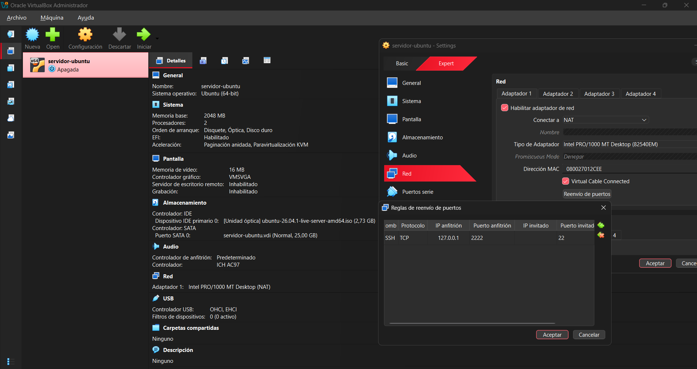

## 2. Instalación y auditoría inicial

Instalación manual (sin instalación desatendida), sistema en inglés y disco con **LVM**, que permite ampliar volúmenes sin reinstalar. OpenSSH no se instaló desde el instalador, para hacerlo a mano después.

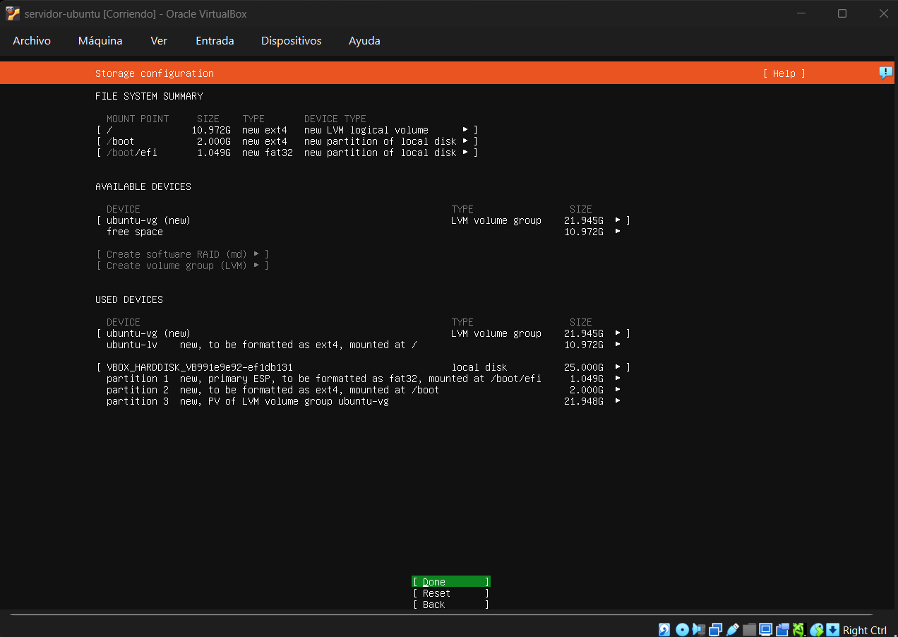

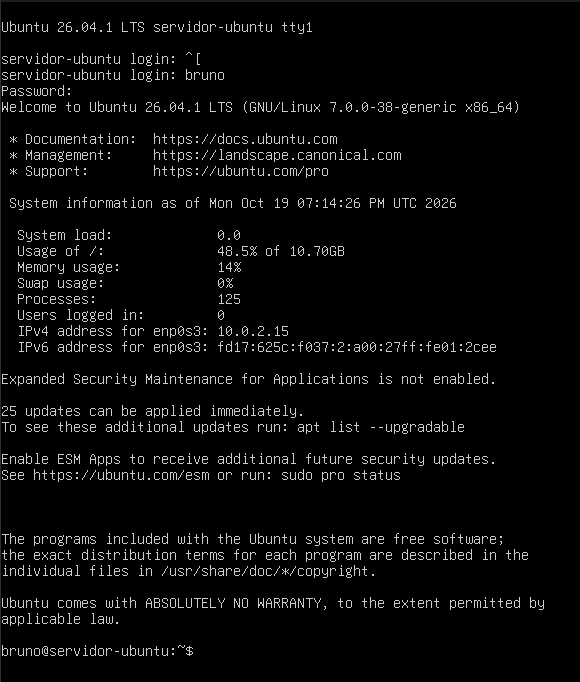

Antes de cambiar nada, medí el estado del servidor recién instalado con Lynis: **61/100**, sin firewall, sin detección de intrusiones y sin escáner de malware.

```bash
sudo apt install lynis -y
sudo lynis audit system
```

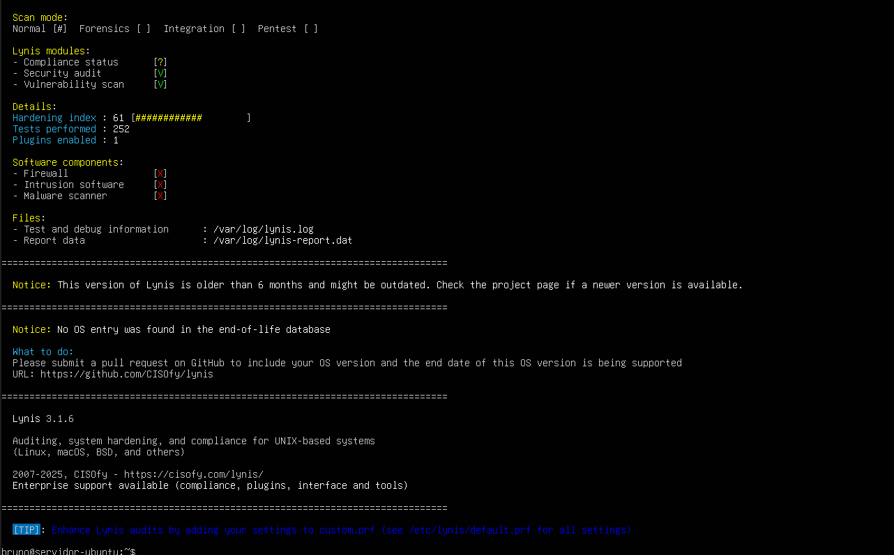

## 3. Acceso remoto por SSH

Instalé OpenSSH y administré el servidor desde la terminal de Windows a través del reenvío de puertos, como se administra un servidor real.

```bash
sudo apt install openssh-server -y
sudo systemctl enable --now ssh
# Desde Windows:
ssh -p 2222 bruno@127.0.0.1
```

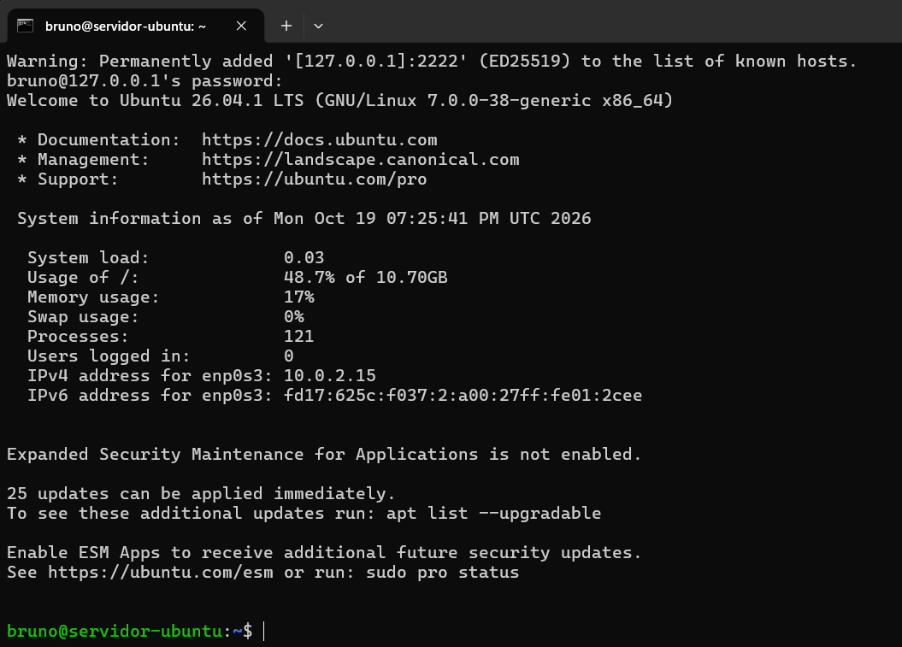

## 4. Ampliación del disco con LVM

El instalador asignó solo 11 GB de los 22 GB disponibles al volumen raíz, que ya estaba al 52 %. Lo amplié **con el servidor en funcionamiento**:

```bash
sudo lvextend -r -l +100%FREE /dev/ubuntu-vg/ubuntu-lv
```

- `-l +100%FREE`: suma todo el espacio libre del grupo de volúmenes.
- `-r`: agranda también el sistema de archivos ext4 en caliente.

Resultado: de **11 GB al 52 %** a **22 GB al 26 %**, sin reiniciar.

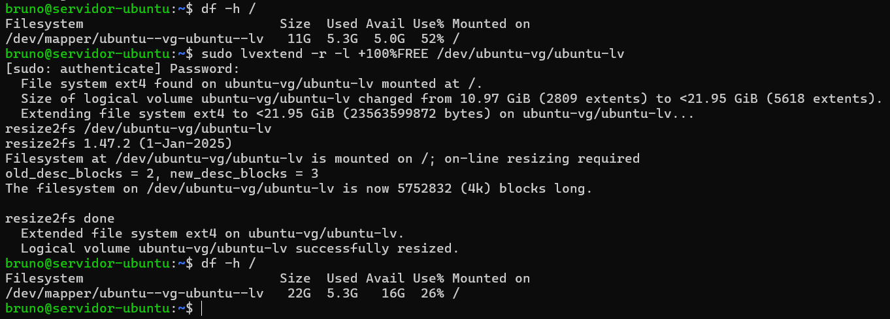

## 5. Hardening de SSH: llaves, sin contraseña, sin root y 2FA

### Llave ED25519 con passphrase

```powershell
# En Windows
ssh-keygen -t ed25519 -C "bruno@notebook"
type $env:USERPROFILE\.ssh\id_ed25519.pub | ssh -p 2222 bruno@127.0.0.1 "mkdir -p ~/.ssh && chmod 700 ~/.ssh && cat >> ~/.ssh/authorized_keys && chmod 600 ~/.ssh/authorized_keys"
```

La llave privada nunca sale de la notebook y está protegida con passphrase.

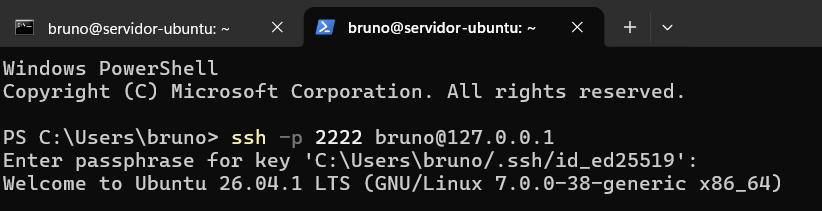

### Contraseña y root bloqueados

Configuración en un archivo propio, [`configs/ssh/10-hardening.conf`](laboratorio-seguridad/configs/ssh/10-hardening.conf), en lugar de editar el `sshd_config` original (que las actualizaciones pueden pisar):

| Directiva | Efecto |
| --- | --- |
| `PasswordAuthentication no` | Elimina la fuerza bruta de contraseñas |
| `PermitRootLogin no` | root no puede entrar; se usa `sudo` |
| `AllowUsers bruno` | Lista blanca de usuarios |
| `MaxAuthTries 3` / `LoginGraceTime 30` | Menos intentos y menos tiempo para autenticarse |

Siempre validé antes de aplicar (`sudo sshd -t`) y con una sesión de respaldo abierta, para no quedarme afuera.

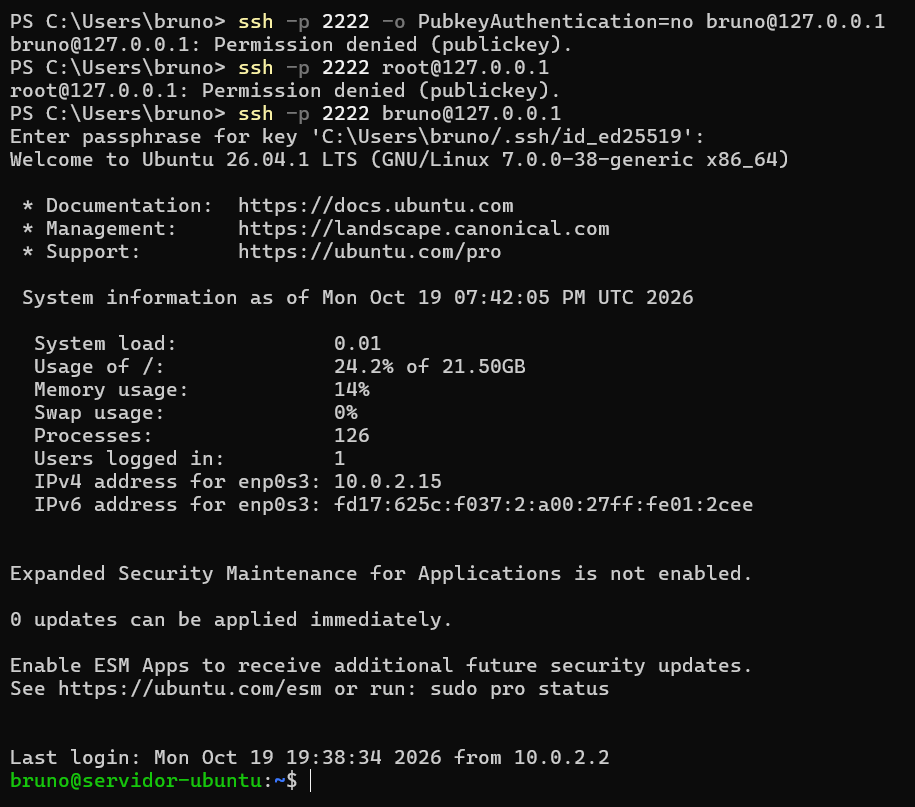

### Autenticación en dos pasos (TOTP)

Entrar exige **algo que tengo** (la llave) y **un código de 6 dígitos** de una app del celular que cambia cada 30 segundos. Aunque roben la notebook con la llave, no pueden entrar.

```bash
sudo apt install libpam-google-authenticator -y
google-authenticator   # tokens por tiempo, un solo uso por código, límite de intentos
```

- En `/etc/pam.d/sshd`: se comenta `@include common-auth` y se agrega `auth required pam_google_authenticator.so` ([detalle](laboratorio-seguridad/configs/pam/sshd.cambios)).
- En SSH: `AuthenticationMethods publickey,keyboard-interactive` exige **las dos cosas**, en ese orden.

> El secreto TOTP, el QR y los códigos de emergencia no se capturan ni se suben al repositorio.

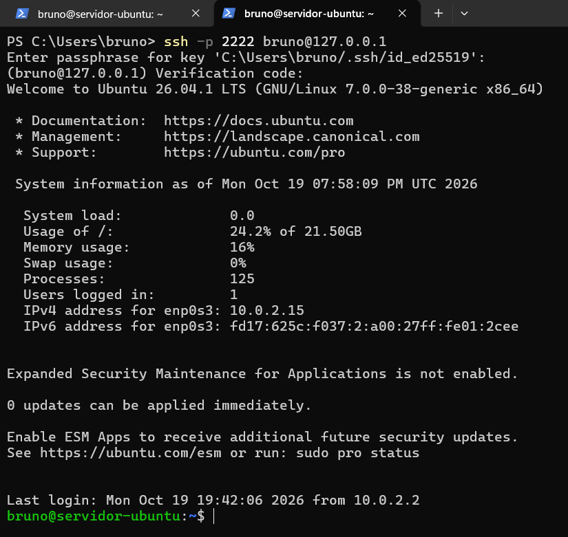

## 6. Firewall y protección contra fuerza bruta

### ufw: se bloquea todo lo que entra, se abre solo lo necesario

```bash
sudo ufw default deny incoming
sudo ufw default allow outgoing
sudo ufw allow 22/tcp comment 'SSH'   # antes de activar, para no perder el acceso
sudo ufw enable
```

Los puertos 80 y 443 se abrieron recién al instalar nginx (principio de mínima exposición).

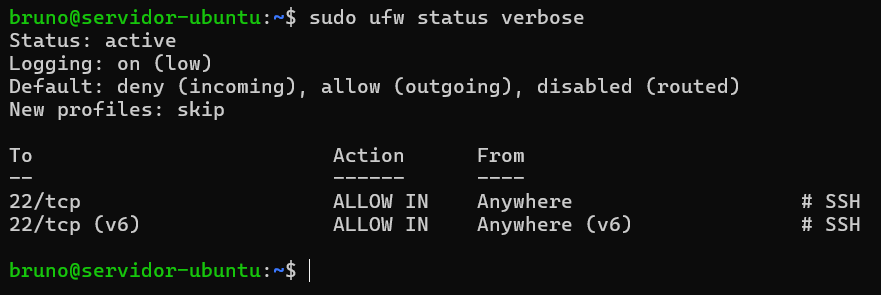

### fail2ban, probado con un ataque

Configuración: [`configs/fail2ban/jail.local`](laboratorio-seguridad/configs/fail2ban/jail.local). Tres fallos en 10 minutos bloquean la IP durante 1 hora, y el bloqueo se aplica como regla del firewall.

**Prueba:** simulé un atacante intentando entrar con un usuario inexistente. Al tercer intento, fail2ban bloqueó la IP y agregó sola una regla `REJECT` en ufw. La sesión ya abierta siguió funcionando, porque el firewall solo bloquea conexiones nuevas.

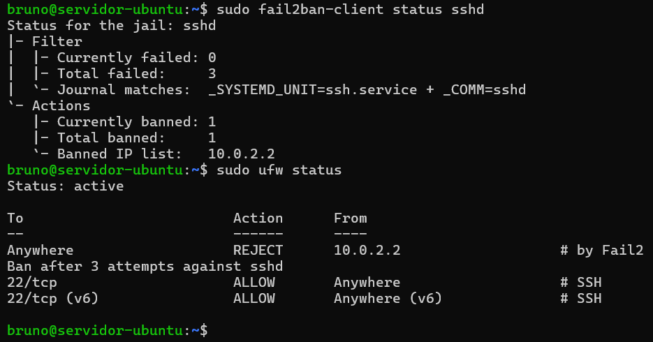

## 7. Actualizaciones de seguridad automáticas

`unattended-upgrades` busca actualizaciones todos los días e instala **solo las de seguridad** (`resolute-security`). Las actualizaciones normales quedan afuera para evitar cambios inesperados.

```bash
cat /etc/apt/apt.conf.d/20auto-upgrades
sudo unattended-upgrade --dry-run --debug
```

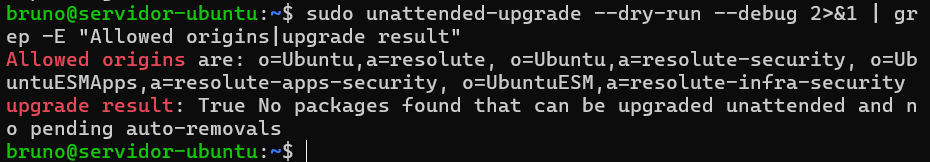

## 8. Servidor web con HTTPS

### nginx

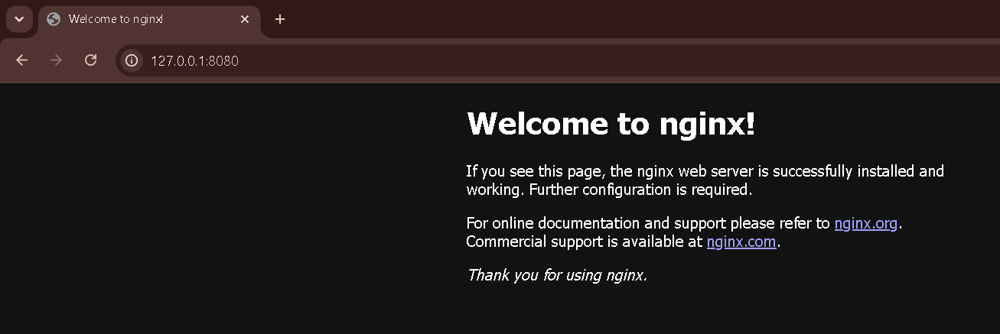

### Certificado TLS y redirección

Generé un certificado autofirmado (el laboratorio no tiene dominio público). Todo lo que entra por HTTP se redirige a HTTPS, y solo se aceptan TLS 1.2 y 1.3 con cifrados recomendados por Mozilla. Configuración: [`configs/nginx/default`](laboratorio-seguridad/configs/nginx/default).

```bash
sudo openssl req -x509 -nodes -days 365 -newkey rsa:2048 \
  -keyout /etc/ssl/private/nginx-lab.key -out /etc/ssl/certs/nginx-lab.crt \
  -subj "/CN=servidor-ubuntu" -addext "subjectAltName=IP:127.0.0.1,DNS:localhost"
```

El navegador muestra "No seguro" porque el certificado no lo firmó una autoridad reconocida: **la conexión sí está cifrada**, lo que no se puede verificar es la identidad del servidor. En un servidor con dominio usaría Let's Encrypt.

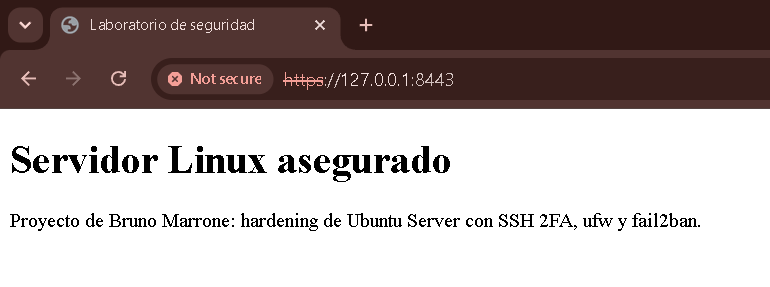

Verificación con `openssl`: **TLS 1.3** con cifrado **AES-256-GCM**.

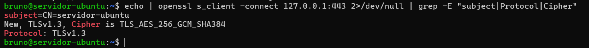

### Cabeceras de seguridad y versión oculta

Antes, el servidor anunciaba su versión exacta (`nginx/1.28.3 (Ubuntu)`), lo que facilita buscar vulnerabilidades conocidas, y no enviaba ninguna cabecera de seguridad.

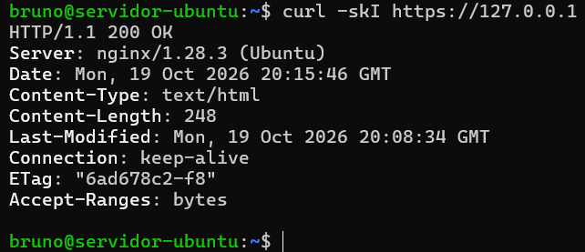

Después: versión oculta (`server_tokens off`) y 6 cabeceras ([`security-headers.conf`](laboratorio-seguridad/configs/nginx/security-headers.conf)).

| Cabecera | Protege contra |
| --- | --- |
| Strict-Transport-Security | Volver a HTTP sin cifrar |
| X-Content-Type-Options | Que el navegador interprete un archivo como otro tipo |
| X-Frame-Options | Clickjacking |
| Referrer-Policy | Filtrar URLs a otros sitios |
| Content-Security-Policy | Cargar scripts de otros orígenes (XSS) |
| Permissions-Policy | Uso de cámara, micrófono o ubicación |

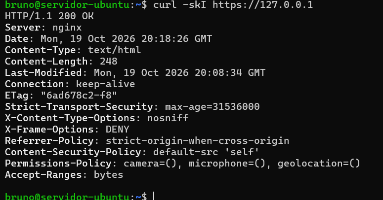

## 9. Backups automáticos y cifrados

Script: [`scripts/backup-servidor.sh`](laboratorio-seguridad/scripts/backup-servidor.sh), ejecutado todos los días a las 03:00 UTC por [cron](laboratorio-seguridad/configs/cron/backup-servidor).

- Respalda `/etc` (configuración), `/var/www` (sitio) y `/home/bruno`.
- **Comprime y cifra en un solo flujo** con GPG (RSA 4096): nunca queda una copia sin cifrar en el disco.
- Cifra con la llave **pública**, así funciona sin contraseña; descifrar exige la passphrase de la llave privada.
- Guarda los últimos 7 días y registra cada ejecución en el journal del sistema.
- La llave privada tiene una copia fuera del servidor: si el servidor se pierde, los backups se pueden recuperar.

**Un backup que nunca se probó no sirve.** Restauré un archivo del backup cifrado y verifiqué con `diff` que fuera idéntico al original:

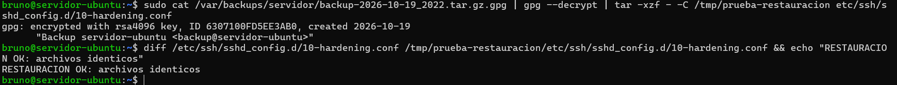

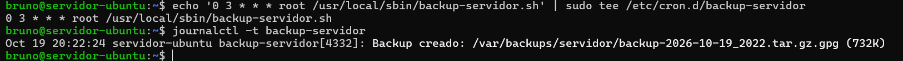

## 10. Detección: rkhunter, auditd y AIDE

### rkhunter: rootkits y binarios modificados

El primer escaneo dio 3 advertencias. Las analicé y **las tres eran falsos positivos**:

| Alerta | Análisis |
| --- | --- |
| `PermitRootLogin` sin configurar | rkhunter solo lee `sshd_config`, no los archivos de `sshd_config.d`. `sudo sshd -T` confirmó `permitrootlogin no` |
| `/etc/.resolv.conf.systemd-resolved.bak` | Respaldo legítimo del sistema de DNS de Ubuntu |
| `/etc/.updated` | Marca legítima de systemd |

Las resolví y el escaneo quedó limpio. Además corre todos los días.

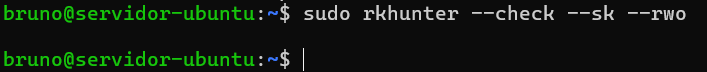

### auditd: quién cambió qué

Reglas en [`configs/audit/hardening.rules`](laboratorio-seguridad/configs/audit/hardening.rules): vigilan usuarios, contraseñas, sudoers, SSH y nginx. Al modificar un archivo vigilado, auditd registra el comando, el archivo, la sesión y, sobre todo, el **`auid`**: el usuario que inició sesión, aunque haya usado `sudo`.

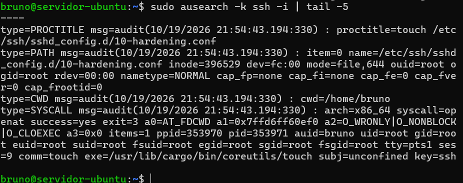

### AIDE: integridad de archivos

AIDE guarda la huella (hash) de todos los archivos del sistema. Después de cambiar el banner, el chequeo lo detectó: `/etc/issue` con el hash (`H`), el tamaño (`>`) y las fechas modificados.

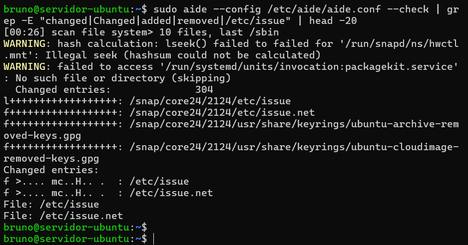

## 11. Hardening del sistema

| Mejora | Archivo |
| --- | --- |
| Banner legal antes del login | `/etc/issue`, `/etc/issue.net` |
| SSH sin túneles ni reenvío de agente, sesiones inactivas cortadas, logs detallados | [`10-hardening.conf`](laboratorio-seguridad/configs/ssh/10-hardening.conf) |
| 10 parámetros del kernel (punteros, BPF, SysRq, filtrado de rutas, paquetes anómalos) | [`99-hardening.conf`](laboratorio-seguridad/configs/sysctl/99-hardening.conf) |
| Protocolos sin uso y almacenamiento USB deshabilitados | [`modprobe/hardening.conf`](laboratorio-seguridad/configs/modprobe/hardening.conf) |
| Permisos por defecto 027, cron y sudoers solo root, compiladores solo root | `login.defs`, `chmod` |
| Contraseñas: vencimiento anual, calidad mínima, más rondas de hash | `login.defs`, `chage`, `libpam-pwquality` |

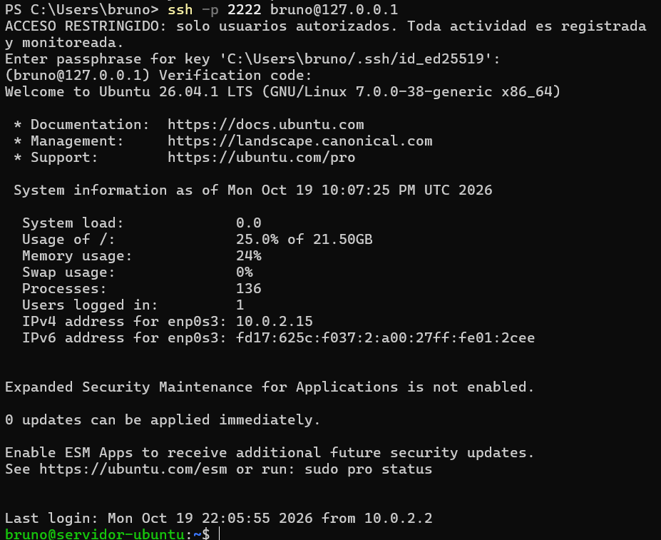

## 12. Resultado final

| Auditoría | Hardening index | Pruebas | Firewall | IDS | Malware |
| --- | --- | --- | --- | --- | --- |
| Inicial | 61 | 252 | ❌ | ❌ | ❌ |
| Hardening principal | 68 | 266 | ✅ | ✅ | ❌ |
| Ronda 2 | 79 | 274 | ✅ | ✅ | ✅ |
| **Final** | **81** | 274 | ✅ | ✅ | ✅ |

Sin advertencias. Para un servidor en uso, 70–80 se considera bien endurecido; los puntos que faltan corresponden casi todos a sugerencias que decidí no aplicar ([sección 14](#14-decisiones-lo-que-no-apliqué-y-por-qué)).

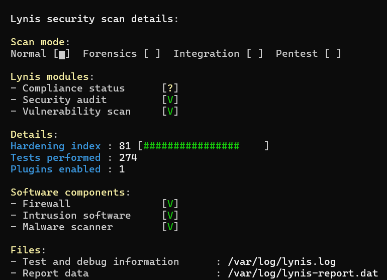

## 13. Problemas encontrados y cómo los resolví

**La web no cargaba desde la notebook.** Diagnóstico por capas, del servidor hacia afuera:

| Capa | Prueba | Resultado |
| --- | --- | --- |
| Servicio | `curl -I http://localhost` (en el servidor) | `200 OK`: nginx funcionaba |
| Camino | `curl.exe -I http://127.0.0.1:8080` (en Windows) | Error: el problema estaba en el medio |
| Reenvío | `VBoxManage showvminfo ... \| findstr Forwarding` | Solo existía la regla SSH |

Solución: agregué las reglas con `VBoxManage controlvm servidor-ubuntu natpf1`, sin apagar la máquina.

**nginx no aplicaba las cabeceras.** `nginx -t` fallaba con `"server_tokens" directive is duplicate`: Ubuntu ya define `server_tokens build;` en `nginx.conf`. Como recargaba con `nginx -t && systemctl reload nginx`, la configuración rota nunca se aplicó. Lo resolví editando la directiva original en lugar de duplicarla.

**Un secreto compartido por error.** El secreto del 2FA quedó expuesto durante la configuración. Lo traté como comprometido: lo descarté y generé uno nuevo.

**Incidente evitado al limpiar paquetes.** `apt purge '~c'` intentó purgar restos de `grub-pc` y preguntó si borrar `/boot/grub`. Respondí **No**: el GRUB de EFI usa esa carpeta y el servidor no habría arrancado. Verifiqué los paquetes `grub-efi-amd64` y reinicié para confirmar el arranque. Lección: revisar qué va a purgar un comando antes de confirmarlo.

## 14. Decisiones: lo que no apliqué y por qué

| Sugerencia de Lynis | Por qué no |
| --- | --- |
| Cambiar el puerto de SSH | Seguridad por oscuridad; ya hay llaves, 2FA y fail2ban |
| `/home` y `/var` en particiones separadas | Requiere reinstalar el servidor |
| `kernel.modules_disabled=1` | Impide cargar drivers y puede romper el sistema |
| Logs a un servidor remoto | Se cubre en el nivel 3 con un SIEM (Wazuh) |
| Contraseña en GRUB | La consola solo es accesible desde VirtualBox en mi notebook |

**Limitaciones conocidas del laboratorio:**
- Certificado autofirmado: en producción, Let's Encrypt.
- Los backups están en el mismo disco: en producción se copian a otro lugar (regla 3-2-1).
- Por la NAT de VirtualBox, todo el tráfico llega desde `10.0.2.2`, así que fail2ban bloquea también a la notebook. En el nivel 5 el atacante tendrá su propia IP.

## 15. Próximos niveles

| Nivel | Objetivo | Herramientas |
| --- | --- | --- |
| **1. Servidor asegurado** | ✅ Este repositorio | Ubuntu, OpenSSH, ufw, fail2ban, nginx, GPG, Lynis, auditd, AIDE |
| 2. Red segmentada | Firewall con zonas DMZ, interna y administración; acceso por VPN | OPNsense, WireGuard |
| 3. Detección | IDS de red y SIEM con alertas | Suricata, Wazuh |
| 4. Monitoreo | Paneles y alertas de caída | Zabbix |
| 5. Ataque y respuesta | Atacar el laboratorio y documentar la detección | Kali Linux, nmap, Python |
| 6. Automatización | Reconstruir el entorno asegurado | Ansible |

---

### Estructura del repositorio

```
├── README.md                      # este documento
└── laboratorio-seguridad/
    ├── capturas/                  # 24 capturas numeradas
    ├── configs/
    │   ├── audit/                 # reglas de auditd
    │   ├── cron/                  # tarea de backup
    │   ├── fail2ban/              # jail.local
    │   ├── modprobe/              # protocolos y USB deshabilitados
    │   ├── nginx/                 # sitio HTTPS y cabeceras
    │   ├── pam/                   # cambios para el 2FA
    │   ├── ssh/                   # 10-hardening.conf
    │   └── sysctl/                # parámetros del kernel
    └── scripts/
        └── backup-servidor.sh     # backup cifrado con GPG
```

> Este repositorio no contiene contraseñas, llaves privadas, secretos de 2FA ni códigos de emergencia.
