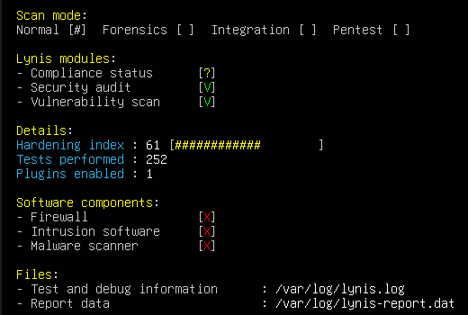
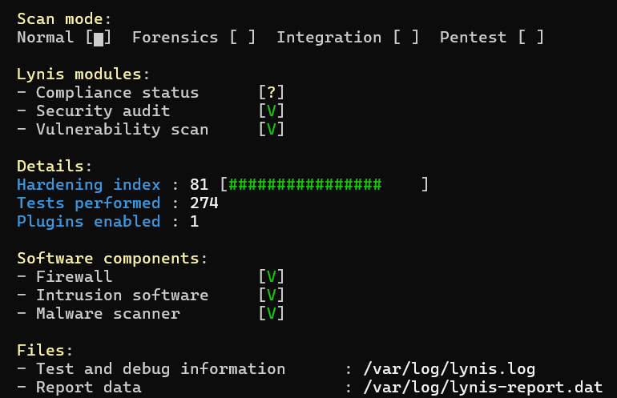

# Servidor Linux asegurado

Un servidor recién instalado funciona, pero no está protegido: cualquiera puede intentar adivinar contraseñas, no hay firewall y nadie se entera si algo cambia. En este proyecto instalé **Ubuntu Server** en una máquina virtual y le apliqué las **medidas de seguridad básicas que cualquier servidor de una empresa debería tener**.

No es todo lo que se puede hacer, pero es la base sobre la que se construye todo lo demás.

<p align="center">
  
  &nbsp;&nbsp;
  
</p>
<p align="center"><b>Auditoría con Lynis:</b> de <b>61/100</b> (servidor recién instalado) a <b>81/100</b> (servidor protegido)</p>

## Resumen

| Medida | Qué previene |
| --- | --- |
| Acceso SSH con llave y código 2FA | Que alguien entre adivinando o robando una contraseña |
| Firewall y fail2ban | Conexiones no autorizadas y ataques de fuerza bruta |
| HTTPS y cabeceras de seguridad | Que se lea el tráfico de la web o se ataque el sitio |
| Backups cifrados | Perder los datos ante una falla o un ataque |
| Detección de cambios | Que alguien modifique el sistema sin que nadie se entere |
| Actualizaciones automáticas | Fallas de seguridad conocidas sin parchear |

---

## 1. Acceso por SSH

**El riesgo:** SSH es la puerta de entrada para administrar el servidor. Si se entra solo con contraseña, un atacante puede probar miles de combinaciones hasta acertar.

**Qué hice:** ahora para entrar hacen falta dos cosas: una **llave** guardada en mi computadora y un **código de 6 dígitos** que genera el celular (2FA). Las contraseñas y el usuario root quedaron bloqueados.

```bash
# /etc/ssh/sshd_config.d/10-hardening.conf
PasswordAuthentication no          # no se aceptan contraseñas
PermitRootLogin no                 # root no puede entrar
AllowUsers bruno                   # solo este usuario
MaxAuthTries 3                     # máximo 3 intentos por conexión
AuthenticationMethods publickey,keyboard-interactive   # llave + código 2FA
```

<p align="center"></p>

**Resultado:** los intentos de entrar con contraseña o como root se rechazan directamente.

<p align="center"></p>

## 2. Firewall y bloqueo de ataques

**El riesgo:** cada servicio abierto es una puerta más para un atacante, y los bots prueban contraseñas sin parar.

**Qué hice:** el firewall (**ufw**) bloquea todo lo que entra, salvo SSH y la web. **fail2ban** vigila los intentos de acceso y bloquea a quien falla 3 veces.

```bash
# Firewall: se cierra todo y se abre solo lo necesario
sudo ufw default deny incoming
sudo ufw allow 22/tcp     # SSH
sudo ufw allow 80,443/tcp # web
sudo ufw enable
```

```ini
# /etc/fail2ban/jail.local
[sshd]
enabled  = true
maxretry = 3     # 3 intentos fallidos...
findtime = 10m   # ...en 10 minutos...
bantime  = 1h    # ...bloquean la IP por 1 hora
```

**Resultado:** simulé un ataque y, al tercer intento, la IP quedó bloqueada automáticamente en el firewall.

<p align="center"></p>

## 3. Servidor web con HTTPS

**El riesgo:** sin HTTPS, los datos viajan sin cifrar y cualquiera en la red puede leerlos. Además, mostrar la versión exacta del servidor le facilita a un atacante buscar fallas conocidas.

**Qué hice:** instalé **nginx** con HTTPS (TLS 1.3), oculté la versión del servidor y agregué cabeceras de seguridad que protegen contra ataques web comunes.

```nginx
ssl_protocols TLSv1.2 TLSv1.3;    # solo versiones seguras de TLS
server_tokens off;                # no mostrar la versión de nginx
add_header X-Frame-Options "DENY";                 # evita clickjacking
add_header Strict-Transport-Security "max-age=31536000";  # obliga a usar HTTPS
```

<p align="center"></p>

## 4. Backups cifrados

**El riesgo:** un disco que falla, un error humano o un ransomware pueden borrar todo. Y un backup sin cifrar es otra copia de los datos que se puede robar.

**Qué hice:** un script hace una copia de seguridad todos los días, cifrada con **GPG**, y guarda los últimos 7 días.

```bash
# Comprime y cifra en un solo paso: nunca queda una copia sin cifrar en el disco
tar -czf - /etc /var/www /home/bruno | gpg --encrypt --recipient-file backup-pub.asc > backup.tar.gz.gpg

# cron: todos los días a las 03:00
0 3 * * * root /usr/local/sbin/backup-servidor.sh
```

**Resultado:** un backup solo sirve si se puede recuperar, así que lo probé: el archivo restaurado salió idéntico al original.

```text
$ cat backup-2026-10-19.tar.gz.gpg | gpg --decrypt | tar -xzf - ...
gpg: encrypted with rsa4096 key, "Backup servidor-ubuntu"
$ diff archivo-original archivo-restaurado && echo "RESTAURACION OK"
RESTAURACION OK: archivos identicos
```

## 5. Detección de cambios

**El riesgo:** si un atacante entra y modifica archivos del sistema, puede pasar mucho tiempo sin que nadie lo note.

**Qué hice:** **AIDE** guarda una "huella" de cada archivo del sistema y avisa si alguno cambia. También instalé **rkhunter**, que busca rootkits, y **auditd**, que registra quién modifica archivos importantes.

**Resultado:** cambié el mensaje de bienvenida del servidor y AIDE lo detectó.

<p align="center"></p>

## 6. Actualizaciones automáticas

**El riesgo:** la mayoría de los ataques aprovechan fallas que ya tienen solución, pero que nadie instaló.

**Qué hice:** el servidor instala solo los parches de seguridad todos los días.

---

## Lo que aprendí

- **Probar cada medida.** No alcanza con configurar: simulé un ataque, restauré un backup y modifiqué archivos para comprobar que todo funcionaba.
- **Diagnosticar por partes.** Cuando la web no cargaba, revisé paso a paso (el servidor, la red, la máquina virtual) hasta encontrar el problema.
- **Revisar antes de confirmar.** Al limpiar paquetes, el sistema ofreció borrar archivos de arranque. Lo cancelé a tiempo; si no, el servidor no hubiera vuelto a encender.

## Próximos pasos

Esta es la base. Lo siguiente es armar una red de empresa completa: firewall con zonas separadas (**OPNsense**), detección de ataques en tiempo real (**Wazuh**), monitoreo (**Zabbix**) y automatización (**Ansible**).

---

**Herramientas:** Ubuntu Server · OpenSSH · ufw · fail2ban · nginx · GPG · Lynis · AIDE · rkhunter · auditd · VirtualBox

Las configuraciones y el script de backup están en [`laboratorio-seguridad/`](laboratorio-seguridad). Este repositorio no contiene contraseñas ni llaves privadas.

**Bruno Marrone** · Estudiante de Analista en Infraestructura Informática, Universidad ORT Uruguay
